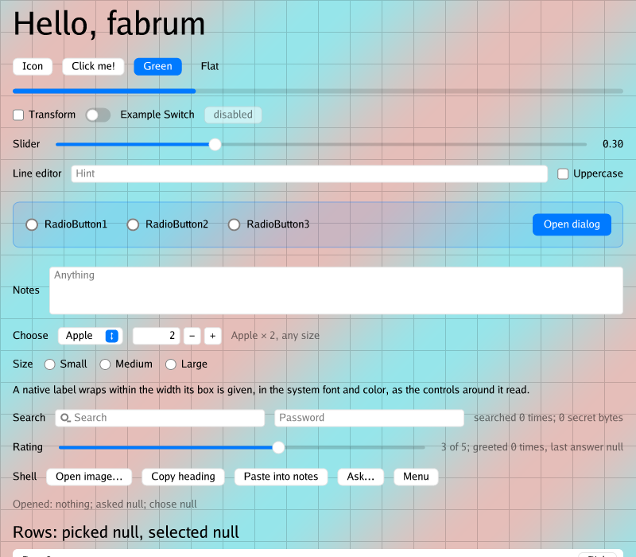
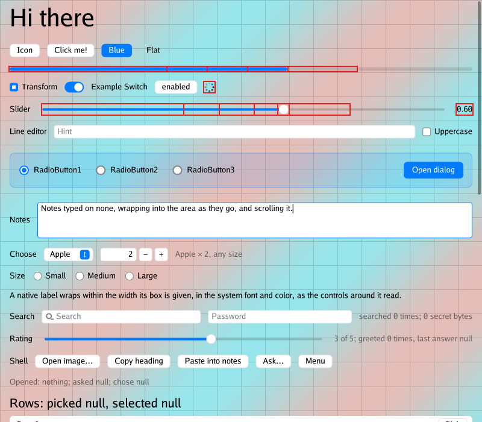
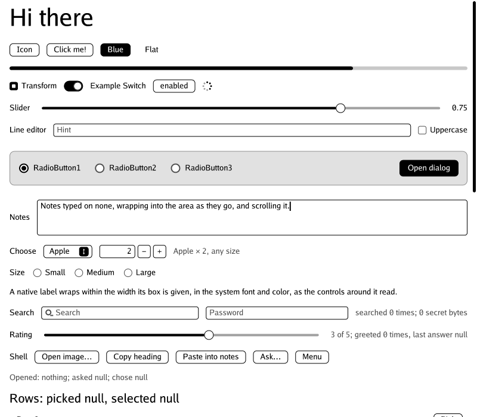

# fabrum-kitchen

A port of [Gio](https://gioui.org)'s Kitchen demo (`gio-example/kitchen`)
to [fabrum](https://github.com/ssttevee/fabrum): one page with every kind
of widget, used to drive fabrum's design. It has two jobs: push fabrum to
grow what it lacked (scrolling, keyboard input and focus, text editing,
dragging, timed frames, dialogs, a file chooser, the clipboard), and check
that the choices fabrum started with hold for a very different kind of app.
It runs on all three of fabrum's platforms from one interface.



## The screen

`src/kitchen.zig` is the interface: `fabrum.app` components and widgets,
nothing of the window or the renderer. Two versions of the first screen:

| Component | What it is |
|---|---|
| `kitchen/Hybrid.zig` | The screen in fabrum's hybrid model: the platform's own controls (buttons, the progress bar, the checkbox, the switch, the slider, the editors, a dropdown, a stepper, a spinner, search and password fields, a wrapping label) laid out by fabrum, with drawn content between and over them (the heading, "Flat", the radio buttons, a drawn modal dialog over the native line editor, clickable rows). The shell row uses the platform's services: a file chooser, the clipboard, a question dialog, a popup menu, a close guard while the line editor has text. On a platform without native controls, `app.widgets` draws every control and the same screen is entirely drawn. |
| `kitchen/Kitchen.zig` | The same screen drawn entirely by fabrum, for comparison (`kitchen --drawn`). |
| `kitchen/theme.zig`, `kitchen/widgets.zig` | Gio's material look (colors, type, icons, the disabled state) and the drawn widgets after Gio's. |

`docs/input-design.md` is the design that the Kitchen drove: what each of
Gio's widgets needs from fabrum, how element events, scrolling, dragging,
focus, text editing, animation, the platform services and window-less
testing were designed, and what of it was built.

## Running it

Zig 0.17.0. Dependencies (fabrum, and the two renderers `kitchen-none` can
draw with) are fetched from GitHub by `zig build`.

| Platform | Build | Run | Binary | What hosts the Kitchen |
|---|---|---|---|---|
| AppKit, macOS (the default) | `zig build` | `zig build run` | `kitchen` | fabrum's AppKit platform: native controls, canvas layers drawn with Quartz. `--drawn` shows `Kitchen.zig` instead; `--disable` disables every widget of the drawn screen, as Gio's `-disable` does. |
| GTK 4 | `zig build -Dplatform=gtk` | `zig build run-gtk -Dplatform=gtk` | `kitchen-gtk` | fabrum's GTK platform: GTK's controls, canvas layers drawn with Cairo. GTK 4 comes from `pkg-config`; with Homebrew on macOS, `PATH=/opt/homebrew/bin:$PATH`. |
| none | `zig build` (always built) | `zig build run-none [-Drenderer=z2d\|thorvg]` | `kitchen-none` | The Kitchen's own host, `src/none.zig`: no window and no toolkit, pixels drawn by a portable renderer. |

`kitchen-none` always uses a fabrum built for the `none` platform, whatever
`-Dplatform` says, and links no OS UI library, so it cross-compiles:
`zig build -Dtarget=x86_64-linux-musl`, `-Dtarget=x86_64-windows-gnu`, or
`-Dtarget=arm-linux-gnueabi.2.38 -Dcpu=cortex_a7` for a PocketBook.

### `kitchen-none`

`src/none.zig` is a host as fabrum's `none` platform means it: the program
that owns the loop, the clock, the pixels and the input, the way a VNC
proxy, a game overlay or an e-reader's toolkit would. It drives the runtime
through the host contract (`fabrum.app.platform.none`) in two modes:

- **overlay**: premultiplied RGBA over a background image, the page left
  out, as a proxy draws over a remote screen. The script's pointer moves,
  clicks, drags, wheel scrolls and keys with their text arrive as a VNC
  client would send them, and each step says whether the app took the
  event or let it through to what is under it;
- **e-ink** (`--eink`): an opaque `gray8` panel with an e-reader's
  capabilities (touch, no hover, no animation, 16 grays, a system keyboard)
  and stand-in services (the keyboard answers a text entry, a dialog is
  answered with its first button). Typing arrives as committed text, and
  each step reports the refresh the runtime asks for (`interactive`,
  `content`, `page`), which an InkView host maps to A2, partial and full
  updates.

`zig build run-none` plays a 19-step script (hover, click, the checkbox,
the switch, the slider, typing into the line editor and Enter, Tab and
Space, the notes area, dragging the slider, scrolling the page, a click
through to the background, the dialog) in both modes. Every step runs the
frames due, takes the changed regions, redraws only those with the
renderer, composites only those, and prints a row:

```
kitchen-none (overlay): z2d renderer, 800x700 rgba8_premultiplied, writing to /tmp/kitchen-snapshots/p2
step             taken regions    pixels    frame    render composite  refresh     next frame
initial              -       1    560000  14789us  115678us   16377us  content     when input comes
hover-green        yes       2      4680   1186us    2801us     182us  content     when input comes
...
drag-slider        yes      19     65489  20541us   14020us    1941us  interactive now
click-through       no       2     47631   3275us   18204us    1423us  content     now
every step: the redrawn damage matched a full redraw
```

After every step it also redraws everything from scratch and fails with
`error.DamageMissed` unless the pixels are the same, which checks fabrum's
damage tracking and the renderer end to end. Snapshots of some steps go to
`/tmp/kitchen-snapshots/p2` (or `--out DIR`): `NN-step.png` is the
composited frame, `NN-step-overlay.png` the overlay alone, and
`NN-step-damage.png` the frame with the step's damage outlined; the e-ink
frames are `eink-NN-step.png`. `--overlay` or `--eink` plays one mode,
`--bench` times full and partial redraws, `--quiet` prints less. Arguments
go after `--`: `zig build run-none -- --eink --out /tmp/eink`.

| | |
|---|---|
|  |  |
| Dragging the slider in the overlay, the step's damage outlined: the slider, its value, the progress bar and the spinner are redrawn, nothing else. | The e-ink panel (`gray8`, high-contrast theme) after the system keyboard committed text into the notes. |

`-Drenderer` picks what it draws with:
[fabrum-renderer-z2d](https://github.com/ssttevee/fabrum-renderer-z2d) (the
default; pure Zig, draws `gray8`) or
[fabrum-renderer-thorvg](https://github.com/ssttevee/fabrum-renderer-thorvg).
The build passes the chosen renderer the Kitchen's own fabrum, since the
renderer packages take the app's rather than fetching their own. **Known
issue:** `zig build run-none -Drenderer=thorvg` fails the damage check with
`error.DamageMissed`: with ThorVG the partial redraw differs from a full
one. Pre-existing; the z2d renderer passes.

### Scripts for the windowed builds

Debug builds of `kitchen` and `kitchen-gtk` read `KITCHEN_SCRIPT`, steps
separated by `;` to run once the window is up, so screens can be checked
without a person at the machine (and, on AppKit, mostly while the Mac is
locked: nothing is posted to the system's event stream). `src/script.zig`
documents the steps: `click=<text>`, `type=<key>:<text>`, `press=<key>`,
`slide=<key>:<value>`, `select=<key>:<index>`, `tab`, `menu=<menu>/<item>`,
`answer=<index>`, `choose=<path>`, `resize=<w>x<h>`, `dump`,
`snapshot=<path>`, `wait=<ms>`, `quit` and more. For example:

```sh
KITCHEN_SCRIPT='type=line:Hello;tab;dump;snapshot=/tmp/a.png;quit' zig build run
```

On AppKit, `KITCHEN_LAYOUT_FILE` makes the app write where the hybrid
screen's elements are, for drivers that click them with real input.

## Tests

The interface and its update logic run without a window, through
`fabrum.app.testing.Harness`, against fabrum's heuristic text measurement
and its fake native widget tree (or its drawn widgets), on any OS.

| Command | Test binaries | What runs |
|---|---|---|
| `zig build test` | 27 + 30 + 31 | the interface on the fake native tree (`src/kitchen.zig`), the AppKit program's (`src/main.zig`: the interface, the icons and the script), and `kitchen-none`'s |
| `zig build test -Dplatform=none` | 27 + 31 | the interface with drawn widgets, and `kitchen-none`'s |
| `zig build test -Dplatform=gtk` | 27 + 29 + 31 | the interface on GTK's fake tree, the GTK program's, and `kitchen-none`'s (`PATH=/opt/homebrew/bin:$PATH` on macOS with Homebrew) |

`kitchen-none`'s 31 (`src/none.zig`: the interface with drawn widgets, the
script playing through in both modes with the damage always matching a
full redraw, and `src/png.zig`'s encoder) are the same binary whatever
`-Dplatform` says, so after one platform's run the others report them as
cached and their summaries count 27 and 56. With `-Drenderer=thorvg` the
script test fails (see above).

## Files

| File | What it is |
|---|---|
| `src/kitchen.zig` | The interface and its tests; `window_size` (Gio's 800×700) |
| `src/kitchen/Hybrid.zig` | The hybrid screen (above) |
| `src/kitchen/Kitchen.zig` | The all-drawn screen |
| `src/kitchen/theme.zig`, `src/kitchen/widgets.zig` | Look and drawn widgets after Gio's material ones |
| `src/main.zig` | The AppKit program; `src/icons.zig` loads the Bootstrap SVG icons as Quartz pictures |
| `src/main_gtk.zig` | The GTK 4 program and its in-process script |
| `src/none.zig` | The `none` host: overlay and e-ink modes, the script, the damage check, snapshots, `--bench` |
| `src/script.zig` | `KITCHEN_SCRIPT` on AppKit: the steps, and `KITCHEN_LAYOUT_FILE` |
| `src/png.zig` | A small PNG encoder (8-bit RGBA, zlib through `std.compress.flate`) for the snapshots |
| `docs/input-design.md` | The design the Kitchen drove, and what of it was built |
| `src/fonts/Go-Regular.ttf`, `src/icons/` | The Go font (BSD) and two Bootstrap icons (MIT) |
